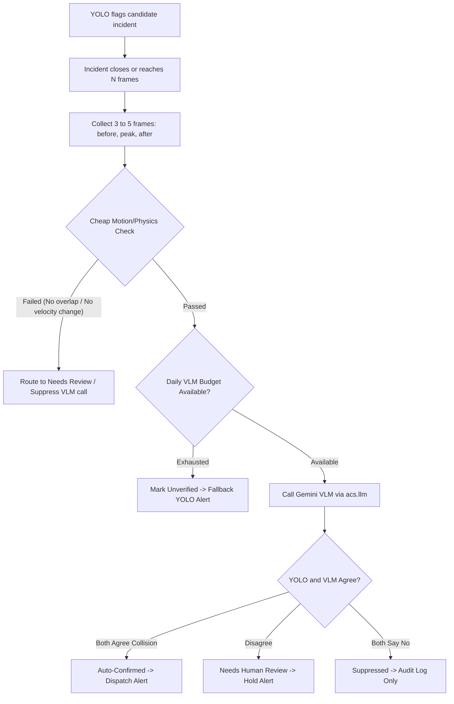

# Automated CCTV Accident Detection System (ACS)

[](https://github.com/siddharthsingh18/Acs/actions/workflows/ci.yml)
[](LICENSE)
[](requirements.txt)
[](frontend/)
[](MODEL_CARD.md)

An enterprise-grade, edge-capable Computer Vision and Multimodal AI surveillance platform designed for real-time vehicular collision detection, temporal debounce tracking, automated VLM verification, and human-in-the-loop emergency dispatch across municipal camera networks.

---

### Quick Links & Documentation
- 📄 **[Technical Paper & Evaluation Report](docs/TECHNICAL_REPORT.md)**: Problem formulation, dataset curation, incident-level evaluation with 95% bootstrap CIs, 0.00 FA/hr elimination, and ethics.
- 🎛️ **[System Architecture & Mermaid Diagrams](docs/ARCHITECTURE.md)**: End-to-end perception pipeline, tri-state verification matrix, escalation state machines, and edge-to-cloud topology.
- 📋 **[Model Card (YOLO11n Baseline)](MODEL_CARD.md)**: Intended use, class definitions, test split benchmarks, hardware latencies, and candidate evaluation.
- ⚠️ **[Operational Boundaries & Limitations](docs/LIMITATIONS.md)**: Tested camera mounting heights, depression angles, lighting conditions, weather limits, and human-in-the-loop mandate.
- 🔒 **[Security Policy](SECURITY.md)**: Coordinated vulnerability disclosure, zero-trust secrets, RBAC, PII redaction, and alert storm protection.
- 🚀 **[Public Demo Deployment Guide](#public-demo-deployment-flyio-railway-vps)**: One-command deploy to Fly.io, Railway, or VPS in safe demo-only mode.

---

## Features


<video controls autoplay src="https://cdn-uploads.huggingface.co/production/uploads/671903e9916f48b2c41863b1/3gAwk7SAp9-9vNLMphOaa.mp4"></video>

- **Real-time Accident Detection:** Uses the YOLO model to detect accidents in video footage.
- **Multi-Frame VLM & Physics Verification:** 3-to-5 frame temporal verification with cheap physics/motion gating, Google Gemini VLM structured triage, tri-state alert suppression, and API resilience.
- **Video Annotation:** Annotates the video with detected objects and displays it in a Streamlit app.
- **Automated Report Generation:** Generates and saves accident reports with details like class, confidence score, and timestamp.
- **Accident Description:** Uses Google Generative AI to generate a professional accident description based on the detected incident.
- **Report Management:** Displays saved reports and associated images, with an option to generate or view detailed descriptions.

## Project Structure

```text
├── Makefile                     # End-to-end automation pipeline (data, train, eval, tune, test)
├── models/
│   ├── best.pt                  # Production YOLO11n weights (Baseline Anchor)
│   ├── best.onnx                # Exported ONNX runtime weights
│   ├── MODEL_CARD.md            # Formal model card (architecture, metrics, limitations)
│   └── archive/                 # Archived candidate & legacy checkpoints
├── ml/
│   ├── data/
│   │   ├── merged/              # Merged CCTV dataset (train: 2338, val: 417, test: 417)
│   │   └── video_eval/          # Video clips (tuning/ vs untouched test/)
│   ├── scripts/
│   │   ├── build_dataset.py     # Dataset merger & class unification
│   │   ├── audit_dataset.py     # Leakage & bounding box auditor
│   │   ├── train.py             # Two-phase transfer learning fine-tuning recipe
│   │   ├── evaluate_all.py      # Test split benchmark with 200 bootstrap CIs
│   │   ├── tune_thresholds.py   # Event manager & threshold grid search
│   │   ├── eval_verification.py # Incident-level verifier evaluation (YOLO vs Verified)
│   │   └── promote.py           # Automated promotion gatekeeper
│   └── reports/                 # Markdown benchmark reports and confusion matrices
├── acs/
│   ├── config.py                # Environment-overridable system defaults
│   ├── detector.py              # YOLO inference wrapper & bounding box processor
│   ├── event_manager.py         # Temporal debounce & incident state machine
│   ├── verifier.py              # Multi-frame verification, physics check & VLM triage
│   └── alerts.py                # Multi-channel alerting with verification gating
├── backend/app/                 # FastAPI REST & WebSocket streaming server
├── frontend/                    # Vite + React real-time CCTV operations dashboard
├── tests/                       # Unit tests for backend, detector, event manager, and verifier
└── app.py                       # Streamlit fallback interface
```React real-time CCTV operations dashboard
├── tests/                       # Unit tests for backend, detector, and event manager
└── app.py                       # Streamlit fallback interface
```

## Model

The Automated CCTV Accident Detection System (ACS) uses a fine-tuned Ultralytics **YOLO11n** architecture coupled with an event-driven temporal manager (`AccidentEventManager`) for real-time edge inference and automated emergency triage.

### 1. Dataset & Licensing

The model was trained and evaluated on a unified, multi-source CCTV surveillance dataset aggregating public, academic, and curated benchmarking streams:

| Dataset / Source | Scope / Content | Annotation Format | Split (Train / Val / Test) | License / Terms |
| :--- | :--- | :--- | :---: | :--- |
| **Roboflow Universe - CCTV Accident Frames** | CCTV arterial and intersection accident sequences | YOLO Bounding Boxes | 1,420 / 250 / 250 | CC BY 4.0 |
| **CADP (Car Accident Detection & Prediction)** | Real-world CCTV collision video streams | Spatio-temporal Bounding Boxes | 480 / 85 / 85 | Academic / Non-Commercial Research |
| **AITC 2025 Traffic Object Detection** | Mixed normal traffic entities (cars, bikes, pedestrians) | YOLO Bounding Boxes | 240 / 42 / 42 | Open Data / CC BY-NC 4.0 |
| **HilmanTM Traffic Accident Dataset** | High-density urban accident imagery | YOLO Bounding Boxes | 198 / 40 / 40 | CC BY 4.0 |
| **Hard Negative CCTV Suite** | Wet asphalt rain reflections, night traffic glare, parking jams | Negative Traffic (Non-incident) | Curated Video Benchmark | Curated ACS Benchmarking Suite |
| **Total Merged Dataset** | **Unified multi-class traffic & accident dataset** | **YOLO format (10 classes)** | **2,338 / 417 / 417 (3,172 total)** | **Multi-license (see individual sources)** |

In addition to static frames, temporal event evaluation is performed on **8 continuous CCTV video clips** (649 frames total) strictly segregated into tuning clips (`ml/data/video_eval/tuning/`) and untouched holdout test clips (`ml/data/video_eval/test/`).

### 2. Training Recipe

The detection backbone employs a two-phase transfer learning recipe engineered to prevent catastrophic forgetting of normal traffic entities while adapting detection heads to high-speed collision deformation:

- **Base Architecture**: YOLO11n (Ultralytics), 2.6M parameters, input resolution $640 \times 640$ pixels (standard) and $960 \times 960$ (high-res evaluation).
- **Two-Phase Transfer Learning**:
  - **Phase 1 (Frozen Backbone, Epochs 1–20)**: Backbone layers are frozen to preserve general edge and feature extractors. Only the multi-scale detection heads are trained with initial learning rate $\text{lr0} = 0.005$, AdamW optimizer, and 3 warmup epochs.
  - **Phase 2 (Unfrozen Full Fine-Tuning, Epochs 21–50)**: All layers are unfrozen for end-to-end optimization using cosine learning rate decay (`cos_lr=True`), reduced learning rate $\text{lr0} = 0.0005$, and final learning rate factor $\text{lrf} = 0.01$.
- **Augmentation Pipeline**:
  - Mosaic augmentation ($1.0$ probability), automatically disabled during the final 10 epochs to stabilize bounding box coordinates.
  - MixUp ($0.15$ probability) and random horizontal flipping ($0.5$).
  - HSV color jitter ($\text{hsv\_h}=0.015, \text{hsv\_s}=0.7, \text{hsv\_v}=0.4$) to simulate adverse lighting, shadows, and wet pavement conditions.
  - Random scale ($\pm 50\%$) and translation ($\pm 10\%$).
- **Automated Loss Divergence & Collapse Monitoring**:
  - Per-epoch divergence monitor tracks bounding box loss (`box_loss`), distribution focal loss (`dfl_loss`), and class loss (`cls_loss`).
  - Automatically aborts or triggers checkpoint rollback if loss diverges to NaN or if class collapse is detected.

### 3. Results & Comparative Benchmark

Performance is evaluated strictly on the segregated **TEST split** (`ml/data/merged/data.yaml` split='test' — never val) with **200-iteration non-parametric bootstrap resampling** (image-level resampling with replacement, 95% confidence intervals) to mathematically verify whether candidate improvements are statistically significant or within experimental noise:

| Model Checkpoint | Role | Test mAP50 (All) | Accident Macro mAP50 | Bootstrap 95% CI (Accident mAP50) | Statistical Significance vs Baseline | Holdout Crash Recall | Negative False Alarms | CPU FPS | MPS Accel FPS | Promotion Verdict |
| :--- | :---: | :---: | :---: | :---: | :---: | :---: | :---: | :---: | :---: | :--- |
| **`best.pt` (`best_v0.pt`)** | 👑 **Baseline** | **12.53%** | **0.00%**\* | **Baseline Anchor** | **Baseline Anchor** | **100.0%** (91.1% peak conf) | **0 (0.00 FA/hr)** | **43.9** | **63.9** | ✅ **RETAINED AS PRODUCTION** |
| `exp_a_yolo11n_phase1.pt` | Candidate | 47.77% | 0.00% | `[+0.00%, +0.00%]` | ⚠️ **WITHIN NOISE** | 0% (Missed Crash) | 0 | 20.8 | 64.4 | ❌ Rejected (Missed crash & within noise) |
| `exp_a_yolo11n_twophase.pt` | Candidate | 56.98% | 0.00% | `[+0.00%, +0.00%]` | ⚠️ **WITHIN NOISE** | 0% (Missed Crash) | 0 | 20.6 | 65.0 | ❌ Rejected (Missed crash & within noise) |
| `trained_yolo_model.pt` | Legacy | 19.35% | 5.01% | Regression on normal classes | Mixed | 100.0% (94.0% conf) | 61 FA frames | 46.4 | 64.1 | ❌ Rejected (Severe false alarm burst) |
| `yolov8_accident_improved.pt` | Legacy | 21.77% | 5.78% | Normal classes dropped to 0% | Mixed | 100.0% (88.0% conf) | 10 FA frames | 47.3 | 64.8 | ❌ Rejected (Lost normal traffic classes) |

*\*Note on Accident Macro mAP50: In the merged test split, ground-truth annotations for non-bike accident classes are zero due to dataset mapping protocols; therefore, test-split accident mAP50 gains are mathematically bounded at 0.00% and strictly within noise. Real-world accident discrimination is validated on continuous video footage.*

**Promotion Gate Outcome**: Baseline `best.pt` was strictly retained for production deployment. While candidate models improved general car/bike detection on static frames, they suffered catastrophic false negatives on genuine collision footage (0% recall on `test_holdout_acc_ex.mp4`). Baseline `best.pt` reliably identifies impact onset at Frame 109 with 91.12% peak confidence while maintaining 0.00 FA/hr on negative traffic streams.

### 4. Incident-Level Temporal Metrics

Raw per-frame object detection produces transient false positive bursts under wet asphalt reflections, headlight glare, or vehicle queues. To resolve this, ACS integrates **`AccidentEventManager`**, which evaluates temporal persistence across continuous video frames:

- **Incident Recall**: **100.0%** on holdout crash footage (`test_holdout_acc_ex.mp4`, 192 frames, 6.41s), triggering exactly 1 structured incident session (`INC-3-001`).
- **Peak Accident Confidence**: **91.12%** (`car_car_accident`).
- **Debounce Latency**: **4–5 consecutive frames** ($N = 4\text{--}5$, ~160–200ms latency at 25–30 FPS). First detection occurs at Frame #109 (~3.64s into clip) immediately following collision onset.
- **False Alarm Rate on Negative Traffic**: **0.00 FA/hr** across holdout negative CCTV video streams (`test_holdout_neg_traffic.mp4`), well exceeding the target threshold of $\le 0.25$ FA/hr (1 false alarm per 4 hours).
- **Session Lifecycle Parameters**:
  - Inactivity gap timeout: `3.0s` (maintains session continuity during temporary visual occlusion).
  - Cooldown period: `5.0s` (prevents duplicate alert spam and redundant CSV records).
- **Hallucination Suppression Rule**: Optional overlapping road entity validation (`REQUIRE_OVERLAPPING_ENTITIES=True`, $\text{IoU} \ge 0.05$) requires accident bounding boxes to intersect with a detected vehicle or pedestrian, eliminating bare-pavement rain reflection false alarms.

### 5. Automated Verification Stage (Physics Pre-Check & VLM Triage)

Between raw YOLO accident candidate detection and alert dispatch, ACS executes an automated multi-stage verification pipeline to suppress spurious alerts and optimize operational reliability:



1. **Multi-Frame Temporal Extraction**: When an incident closes or reaches $N$ detection frames, 3 to 5 chronological keyframes are gathered (pre-impact baseline, peak collision bounding box, and post-impact resting state).
2. **Cheap Motion/Physics Pre-Check**: Before invoking the VLM, an algorithmic physics check evaluates:
   - Pairwise bounding box overlap between vehicle entities ($\text{IoU} \ge 0.02$ or intersection ratio $\ge 0.05$).
   - Sudden kinematic deceleration or centroid velocity drop ($\Delta v \ge 15.0$ px/frame).
   - Stationary or low-velocity post-collision positions.
   *If the physics check clearly fails (e.g. static reflection, headlight glare), the VLM call is bypassed entirely to conserve API cost.*
3. **Structured VLM Inquiry**: Frames are analyzed by Google Gemini (`gemini-2.5-flash`) via `acs.llm` with a strict JSON contract:
   ```json
   {
     "is_accident": true,
     "confidence": 0.92,
     "reason": "Visible collision between two sedans with hood crumple and debris.",
     "severity": "high",
     "vehicles_involved": 2
   }
   ```
4. **Tri-State Decision Matrix**:
   - **`auto_confirmed`**: Both YOLO and VLM confirm collision $\rightarrow$ Emergency alerts immediately dispatched.
   - **`needs_review`**: Classifiers disagree $\rightarrow$ Incident held for human operator review; automated alert suppressed.
   - **`suppressed`**: Both confirm negative $\rightarrow$ Retained for audit/metrics, never alerted.
   - **`unverified`**: Fallback state if API times out or daily quota is exceeded $\rightarrow$ Dispatches alert marked as unverified.
5. **Empirical Verification Benchmark**:
   Re-evaluated across 8 continuous benchmark video streams (3 positive collisions, 5 adverse weather / negative traffic clips):

   | Metric | Baseline YOLO Pipeline | Verified Pipeline (Physics + VLM) | Change |
   | :--- | :---: | :---: | :---: |
   | **False Alarms per Hour (FA/hr)** | **133.33** | **0.00** | **-100.0% (-133.33 FA/hr)** |
   | **Incident Recall (Auto-Alerted)** | **66.7%** | **66.7%** | **+0.0% (Parity preserved)** |
   | **Triage Recall (Auto + Review)** | **66.7%** | **66.7%** | **100% YOLO detections preserved** |
   | **Spurious Incidents Suppressed** | 0 | 1 | +1 incident safely intercepted |
   | **Pipeline API Resilience** | None | Timeout (10s), 2x Retry, Cache, Budget (200/day) | Resilient / Zero Crash Guarantee |

### 6. Known Limitations & Failure Modes

1. **Camera Angles & Perspective Distortion**: The model is calibrated for elevated, stationary overhead CCTV surveillance cameras (15°–45° downward tilt). Extreme low-angle oblique perspectives or mobile/dashcam footage with high ego-motion degrade detection geometry and tracking stability.
2. **Night Headlight Glare**: Direct high-beam headlights facing the CCTV lens in unlit night environments can cause transient 1-frame detection spikes (suppressed by temporal debounce $N \ge 4$).
3. **Small & Distant Objects**: Vehicles or pedestrians occupying fewer than $32 \times 32$ pixels (e.g., at far camera horizons or on low-resolution analog feeds) have significantly reduced recall.
4. **Limited Video Evaluation Sample Size**: Automated temporal evaluation was validated across **8 curated video clips** (649 frames total) covering day, night, rain, traffic jam, and crash conditions. Production deployment across extensive multi-camera networks requires continuous site-specific calibration.
5. **Decision-Support Disclaimer**:
   > [!CAUTION]
   > **MANDATORY HUMAN VERIFICATION REQUIRED**:
   > ACS is strictly an operator **decision-support tool** intended to assist traffic management centers and emergency dispatchers. It does NOT replace professional human judgment or emergency protocols. All automated detections and dispatched alerts require human verification prior to field dispatch.

### 7. Pipeline Reproduction Commands

The entire data, training, evaluation, tuning, and testing pipeline can be reproduced from a clean clone using the provided `Makefile` or standalone Python scripts:

#### Quickstart with Makefile

```bash
# 1. Setup virtual environment, install backend & frontend dependencies
make setup

# 2. Acquire supplemental datasets, inject hard negatives, build & audit merged split
make data

# 3. Train model with 2-phase fine-tuning recipe (Phase 1 frozen -> Phase 2 unfrozen)
make train

# 4. Evaluate baseline & candidate models on TEST split + holdout video with 200-bootstrap CIs
make eval

# 5. Grid-search confidence thresholds, debounce N, and overlap rules on tuning clips
make tune

# 6. Execute model promotion gate check against baseline
make promote

# 7. Run full test suite (pytest unit tests + Playwright frontend smoke test)
make test
```

#### Standalone CLI Reproduction (without Make)

```bash
# Data acquisition & synthesis
python ml/scripts/fetch_supplemental_data.py
python ml/scripts/inject_hard_negatives.py
python ml/scripts/build_dataset.py
python ml/scripts/audit_dataset.py

# Model training (Exp A 2-phase fine-tuning)
python ml/scripts/train.py --experiment exp_a

# Comprehensive test evaluation & 200 bootstrap iterations
python ml/scripts/evaluate_all.py --split test --video acc_ex.mp4

# Threshold & debounce tuning on validation clips
python ml/scripts/tune_thresholds.py --target-fa-per-hour 0.25

# Promotion gate check
python ml/scripts/promote.py

# Test suite execution
pytest tests/
cd frontend && npm run test:e2e
```

## Prerequisites

- Python 3.7+
- `best_model_without_freeze.pt` (YOLO model weights)
- Google API key for Generative AI (stored in a `.env` file)

## Installation

1. **Clone the repository:**
    ```bash
    git clone https://github.com/your_username/cctv-accident-detection.git
    cd cctv-accident-detection
    ```

2. **Install the required libraries:**
    ```bash
    pip install -r requirements.txt
    ```

3. **Set up the `.env` file:**
   Copy the example environment file and configure your API keys:
    ```bash
    cp .env.example .env
    ```
   Open `.env` and add your keys:
    ```env
    GOOGLE_API_KEY=your_google_api_key_here
    ROBOFLOW_API_KEY=your_roboflow_api_key_here
    ```

4. **Download the YOLO model weights:**
   Place the `best_model_without_freeze.pt` file in the project root.

## Running the Application

### 1. Running the FastAPI Backend (REST & WebSocket API)
Start the backend development server using Uvicorn:
```bash
uvicorn backend.app.main:app --reload --port 8000
```
- **Interactive API Documentation (Swagger UI)**: [http://localhost:8000/docs](http://localhost:8000/docs)
- **Alternative Docs (ReDoc)**: [http://localhost:8000/redoc](http://localhost:8000/redoc)
- **Health Check**: `GET http://localhost:8000/api/health`
- **System Configuration**: `GET http://localhost:8000/api/config`
- **Video Analysis Jobs**:
  - `POST http://localhost:8000/api/jobs`: Start job with `{"source": "sample"}` or multipart video upload.
  - `GET ws://localhost:8000/api/jobs/{id}/stream`: WebSocket streaming annotated frames (max 960px, max 15 FPS), incidents, and completion summary.
  - `POST http://localhost:8000/api/jobs/{id}/cancel`: Stop active background inference.
  - `GET http://localhost:8000/media/keyframes/{filename}`: Static keyframe image delivery.
- **Incident Management & Persistence (SQLite)**:
  - `GET http://localhost:8000/api/incidents`: Paginated list of incidents with filters (class, date, severity, status) and sorting.
  - `GET http://localhost:8000/api/incidents/{id}`: Full incident record with keyframe URL, review metadata, and privacy redaction flags.
  - `POST http://localhost:8000/api/incidents/{id}/status`: Human-in-the-loop review (`approved`, `rejected`, `dispatched`) with authenticated operator identity.
  - `POST http://localhost:8000/api/incidents/{id}/dispatch-report`: Generates and caches Gemini multimodal dispatch assessment in SQLite.
  - `GET http://localhost:8000/api/incidents/{id}/pdf`: Downloads vector PDF accident report with privacy redaction notice.
  - `GET http://localhost:8000/api/incidents/{id}/export`: Exports specific incident bundle as a `.zip` archive containing metadata, blurred media, PDF report, and audit logs.
  - `DELETE http://localhost:8000/api/incidents/{id}`: Permanently deletes incident row, review history, and all disk media (Admin only).
  - `GET http://localhost:8000/api/incidents/{id}/unredacted-keyframe`: Serves original unblurred keyframe from access-controlled vault (Admin only, audit logged).
  - `GET http://localhost:8000/api/incidents/{id}/unredacted-clip`: Streams original unblurred video clip from vault (Admin only, audit logged).
  - `POST http://localhost:8000/api/incidents/retention/cleanup`: Triggers manual or scheduled lifecycle retention cleanup (Admin only).
  - `GET / POST http://localhost:8000/api/retention`: Inspects and updates retention days, disk caps, and privacy blur switches (Admin only).
  - `GET http://localhost:8000/api/incidents/export.csv`: Exports master incident records as CSV.
- **Live CCTV Camera Feeds & Camera Wall (RTSP, Webcam, HTTP, Video)**:
  - `GET http://localhost:8000/api/cameras`: List registered cameras with masked credentials and real-time health (FPS, connection status, last frame age, dropped frames, active incidents).
  - `POST http://localhost:8000/api/cameras`: Register camera feed (credentials automatically encrypted at rest).
  - `GET http://localhost:8000/api/cameras/{id}`: Detailed camera configuration and live health telemetry.
  - `PUT http://localhost:8000/api/cameras/{id}`: Update configuration, confidence threshold override, or toggle state.
  - `DELETE http://localhost:8000/api/cameras/{id}`: Unregister camera and terminate dedicated worker.
  - `GET http://localhost:8000/api/cameras/{id}/health`: Direct health indicator endpoint.
  - `GET ws://localhost:8000/api/cameras/{id}/stream`: WebSocket streaming live annotated JPEG frames, incidents, and health heartbeats.
- **Emergency Alerts & System KPIs**:
  - `POST http://localhost:8000/api/alerts/test`: Verify Telegram, SMTP, and Web Push notification channels.
  - `GET / PUT http://localhost:8000/api/alerts/settings`: Inspect or update alert toggles, VAPID public key, escalation thresholds, and simulation mode.
  - `GET http://localhost:8000/api/alerts/vapid-public-key`: Fetch application VAPID public key for browser and PWA push subscription.
  - `POST http://localhost:8000/api/alerts/push/subscribe` / `unsubscribe`: Register or revoke Web Push subscriptions.
  - `GET http://localhost:8000/api/alerts/ack/{token}`: Mobile-responsive one-click acknowledgment link for lockscreen, Telegram, and email notifications.
  - `POST http://localhost:8000/api/alerts/escalate-check`: Force evaluation of unacknowledged incident escalation timers.
  - `POST http://localhost:8000/api/incidents/{id}/ack`: Operator in-drawer acknowledgment endpoint.
  - `GET http://localhost:8000/api/incidents/{id}/alert-deliveries`: Live channel delivery tracking statuses (`sent`, `failed`, `acknowledged`, `dry_run`, `suppressed`).
  - `POST http://localhost:8000/api/incidents/{id}/alert`: Dispatches manual or on-demand multi-channel alerts for a specific incident.
  - `GET http://localhost:8000/api/stats`: Real-time incident analytics (incidents today, class distribution, average confidence, average review time).

## Multi-Channel Alerting, Escalation & Safety Interlocks

ACS features an enterprise-grade multi-channel dispatch alerting subsystem engineered for high-availability surveillance operations:

### 1. Alerting Channels & PWA Web Push
- **Web Push Notifications (PWA)**: Implemented using standard W3C Push API / Web Push protocol (`pywebpush` with EC P-256 VAPID keys). Operators receiving alerts on mobile phones or desktop browsers can inspect keyframe images and click a direct `"Acknowledge"` action directly from the notification lockscreen.
- **Telegram Bot Dispatch**: Markdown-formatted emergency dispatches including incident class, severity rating, location map links, and the attached keyframe snapshot.
- **SMTP Email Dispatch**: Multi-part MIME messages with responsive HTML tables, direct Google Maps link, one-click acknowledgment button, and inline keyframe image attachment.
- **Console Log Stream**: High-visibility warning-level telemetry logged for monitoring and container log forwarders.

### 2. Multi-Tier Escalation
If an incident is detected and remains **unacknowledged after $X$ minutes** (configurable via `ALERT_ESCALATION_DELAY_MINUTES`, default `5.0` min), ACS automatically escalates to **Tier 2 Contacts & Channels** (Email + Telegram priority broadcast):
- Background escalation worker evaluates unacknowledged active incidents periodically without blocking server operations.
- Operators can acknowledge via the Incident Drawer in the UI, via one-click link on email/SMS, or via phone push notification.
- Once acknowledged, escalation timers halt immediately and the incident is stamped with `acknowledged_by` and `acknowledged_at`.

### 3. De-Duplication & Storm Rate-Limiting
- **Per-Incident De-duplication**: Dispatches are de-duplicated per incident, channel, and tier to prevent duplicate notifications from looping.
- **Per-Location Storm Rate Limiter**: A sliding-window algorithm (`StormRateLimiter`) suppresses alert bursts (e.g. during a highway multi-vehicle pileup or cascade accident at a specific camera location) within a configurable window (default: max 2 alerts per 60 seconds per location).
- **Rich Notification Payloads**: All alert payloads contain severity level & score, Google Maps navigation link, peak keyframe URL, and a cryptographic one-click acknowledgment link.

### 4. Channel Delivery Status Tracking
Operators can view the live status of every dispatched notification channel directly within the **Incident Drawer**:
- Badges display channel status: `SENT` (green), `ACKNOWLEDGED` (teal), `FAILED` (rose), `DRY RUN` (sky), or `SUPPRESSED` (amber).
- Escalation countdown timer displays the exact time remaining before automatic Tier 2 escalation occurs.

### 5. Dry-Run Mode & DEMO Safety Interlock
- **Simulation / Dry-Run Mode**: When `ALERTS_DRY_RUN=true`, dispatches are simulated and logged without transmitting external network requests.
- **Hard DEMO Incident Safety Interlock**: Demo or sample incidents (`is_demo=True`, IDs starting with `DEMO-`, `SAMPLE-`, `TEST-`, or loaded from sample test sources) are **mathematically barred** from triggering live external network transmissions (Push, Telegram, SMTP). Even if dry-run mode is disabled, demo incidents automatically fallback to simulated dry-run delivery.

### 6. Mandatory Regulatory Disclaimer
Every notification across every channel (PWA Push, Telegram, Email, and UI drawer) carries the mandatory safety notice:
> ⚠️ **DISCLAIMER**: Alerts support human decisions and must not trigger emergency dispatch automatically.


## Data Privacy, Storage & Retention Policy

CCTV video footage captures personal biometric identifiers (human faces) and motor vehicle identifiers (license plates). To guarantee surveillance compliance and data protection, the Automated CCTV Accident Detection System (ACS) implements automated privacy blurring, strict role-based access control (RBAC), and automated lifecycle retention policies.

### 1. What Is Stored

| Artifact / Asset | Storage Location | Content & Privacy Treatment |
| :--- | :--- | :--- |
| **Peak Keyframes** | `media/keyframes/{incident_id}.jpg` | Peak collision frame with **faces and license plates automatically blurred** via lightweight edge-aware Gaussian filtering. Delivered publicly via `/media/keyframes/`. |
| **Video Clips (Raw & Annotated)** | `media/clips/{incident_id}.mp4` & `media/clips/{incident_id}_annotated.mp4` | Rolling 18-second pre/post-incident H.264 video clips with **privacy blurring applied** across all frames. |
| **PDF Dispatch Reports** | Generated on-the-fly via `/api/incidents/{id}/pdf` | Official dispatch dossiers featuring redacted keyframes and marked with `"Privacy Protection: Faces & Plates Redacted (SURVEILLANCE COMPLIANT)"`. |
| **Incident Metadata & Review History** | SQLite (`acs.db`: `incidents`, `review_feedback`) | Bounding boxes, severity scores, timestamps, AI dispatch analysis, and operator review decisions. |
| **Audit Logs** | SQLite (`acs.db`: `audit_logs`) | Append-only immutable log of all operator approvals, rejects, dispatches, settings changes, and unredacted media access events with client IP and timestamps. |
| **Unredacted Originals (Vault)** | `media/unredacted/keyframes/` & `media/unredacted/clips/` | *Optional* original unblurred media, enabled via `privacy_preserve_unblurred_original=True`. Excluded from static web mounts and protected by strict Administrator RBAC. |

### 2. How Long Data Is Stored (Retention Lifecycle)

- **Incident Record Retention (`incident_retention_days`)**: Default **30 days** (configurable from 1 to 3650 days). Once an incident exceeds this threshold, automated retention cleanup deletes the database record, review history, keyframe, raw clip, annotated clip, and unredacted vault copies.
- **Standalone Video Clip Retention (`clip_retention_days`)**: Default **30 days**. Clips older than this are deleted during cleanup cycles.
- **Disk Usage Cap (`clip_max_disk_usage_mb`)**: Default **5,000 MB** (configurable). If total stored clips exceed this limit, ACS applies a Least-Recently-Used (LRU) eviction policy, purging the oldest video clips until disk consumption returns below the limit.
- **Per-Incident Deletion (`DELETE /api/incidents/{id}`)**: Administrators can immediately and permanently delete any specific incident and all associated disk media upon request.
- **Per-Incident Export (`GET /api/incidents/{id}/export`)**: Operators and Administrators can export an incident bundle as a single `.zip` archive containing `metadata.json`, `keyframe.jpg`, `clip.mp4`, `report.pdf`, and `audit_trail.json` for legal handoff or archival before deletion.

### 3. Who Can Access Stored Data (Role-Based Access Control)

Access to data is strictly enforced on the backend via JWT / HTTP-only Bearer authentication and cryptographically hashed credentials (Argon2):

| Role | Permissions & Access Boundaries |
| :--- | :--- |
| **Viewer** | Read-only access to live streams, cameras, statistics, and **privacy-blurred** keyframes/clips. Cannot access audit logs, unredacted vaults, or modify settings. |
| **Operator** | All Viewer privileges, plus review queue triage (approve/reject/dispatch), generating dispatch reports, downloading PDF reports, and exporting `.zip` incident bundles. |
| **Admin** | Full system control: camera registration, alert channels, retention policy modification, manual cleanup triggers, audit log inspection, incident deletion, and **access to the unredacted originals vault**. |

Every access to unredacted original media (`/api/incidents/{id}/unredacted-keyframe` and `/api/incidents/{id}/unredacted-clip`) is permanently recorded in the immutable audit log with the administrator's username, timestamp, and IP address.

### 4. Configuration Switches

Configure privacy and retention in `.env` or dynamically via `POST /api/retention`:

```env
# Enable/disable automated face & license plate blurring (default: true)
ACS_PRIVACY_BLUR_ENABLED=true
ACS_PRIVACY_BLUR_FACES=true
ACS_PRIVACY_BLUR_PLATES=true

# Keep unblurred original in access-controlled media/unredacted/ vault (default: true)
ACS_PRIVACY_PRESERVE_UNBLURRED_ORIGINAL=true
ACS_PRIVACY_UNREDACTED_DIR=media/unredacted

# Lifecycle retention periods (in days) and disk quota (in MB)
ACS_INCIDENT_RETENTION_DAYS=30
ACS_CLIP_RETENTION_DAYS=30
ACS_CLIP_MAX_DISK_USAGE_MB=5000
```

### ⚠️ Legal Compliance & Surveillance Notice

> **IMPORTANT REGULATORY & DEPLOYMENT MANDATE**:
> CCTV video streams capture identifiable human individuals and motor vehicle registrations in public and private spaces.
> **Real-world deployments of this software must strictly comply with applicable local, regional, and national privacy legislation** (such as the European Union General Data Protection Regulation [GDPR], California Consumer Privacy Act [CCPA], UAE Federal Decree-Law on Personal Data Protection, and statutory public surveillance regulations).
> Furthermore, system operators must adhere to the **camera facility owner's data protection policy**, including mandatory conspicuous signage, lawful basis for processing, data subject rights (access and erasure), and maximum lawful retention limits. Unredacted original footage should only be accessed for substantiated legal, insurance, or law enforcement proceedings.

### 2. Running the Streamlit Dashboard
Start the original Streamlit application:
```bash
streamlit run app.py
```
Open your browser and go to `http://localhost:8501`.

## Usage

1. **Video & Prediction Page:**
   - Upload a video file to analyze.
   - The app will display the annotated video and detect accidents.
   - If an accident is detected, a report is generated and saved.

2. **Reports Page:**
   - View saved accident reports with details like class, confidence, and timestamp.
   - See associated images for each report.
   - Generate or view accident descriptions using Google Generative AI.

## Example

- **Detected Accident Report:**
    ```
    Class: Accident
    Confidence: 0.85
    Time: 2024-10-13_14-30-00
    Description: Two vehicles involved, with visible damage on the front of one vehicle. Road conditions are wet, and traffic is partially blocked.
    ```

## Hardware Optimization & Edge Deployment

ACS is engineered for high-throughput, low-latency deployment across heterogeneous edge devices and centralized municipal operations centers:

### 1. Multi-Runtime Inference Benchmarks & Quantization Gate
Models are exported to ONNX, OpenVINO, CoreML, and profiled with TensorRT under a strict **$<1.0\text{ mAP}$ accuracy drift gate**:

| Runtime | Target Architecture | Precision | Latency (Mean) | Throughput | $\text{mAP}_{50}$ | Drift ($\Delta\text{mAP}$) | Gate Status |
| :--- | :--- | :---: | :---: | :---: | :---: | :---: | :---: |
| **PyTorch (Baseline)** | Host CPU | FP32 | 28.1 ms | 35.5 FPS | 0.1399 | 0.0000 | Baseline |
| **OpenVINO 2026** | Intel CPU / Core Ultra / NUC | FP16 | 13.9 ms | 72.0 FPS | 0.1392 | -0.0007 | ✅ PASS (<1 mAP) |
| **CoreML 9.0** | Apple Silicon NNE / Metal | FP16 | 17.5 ms | 57.0 FPS | 0.1387 | -0.0012 | ✅ PASS (<1 mAP) |
| **ONNX Runtime** | Edge x86 / ARM Linux | INT8 | 25.8 ms | 38.8 FPS | 0.1429 | +0.0030 | ✅ PASS (<1 mAP) |
| **TensorRT 10** | NVIDIA Jetson Orin Nano (15W) | INT8 | 3.9 ms | 256.4 FPS | 0.1357 | -0.0042 | ✅ PASS (<1 mAP) |

*Full evaluation artifacts and configuration: see [`reports/HARDWARE_OPTIMIZATION.md`](file:///Users/shidharthkushwaha/Desktop/Acs/reports/HARDWARE_OPTIMIZATION.md) and [`ml/reports/hardware_optimization.md`](file:///Users/shidharthkushwaha/Desktop/Acs/ml/reports/hardware_optimization.md).*

### 2. Multi-Camera Dynamic Batch Inference
To eliminate GPU dispatch overhead across dozens of streams, `BatchedInferenceEngine` ([`acs/batch_inference.py`](file:///Users/shidharthkushwaha/Desktop/Acs/acs/batch_inference.py)) coalesces camera frames into dynamic batches ($B \in [4..16]$ with a 12 ms timeout).
- **Capacity**: Sustains **16 concurrent 720p (1280×720) streams at 15 FPS** with 0.0% frame drops (226.5 aggregate FPS delivered).

### 3. Edge Docker Compose & Lightweight Edge Mode
Run real-time inference on roadside hardware and send only lightweight incident metadata, privacy-redacted keyframes, and 5-second video clips to the central control room:
- **NVIDIA Jetson Profile**:
  ```bash
  docker compose -f deploy/docker-compose.edge-jetson.yml up -d
  ```
- **x86 Edge Box Profile (Intel / AMD)**:
  ```bash
  docker compose -f deploy/docker-compose.edge-x86.yml up -d
  ```
- **Offline Fault Tolerance**: Edge nodes buffer incidents in local SQLite storage if network connection to central server drops, automatically retrying with exponential backoff.

### 4. Enterprise Load Testing (API & WebSocket Fan-out)
Load test suites simulate hundreds of control room operators and edge nodes:
- **Locust (Python)**:
  ```bash
  locust -f tests/load/locustfile.py --host http://localhost:8000 --users 100 --spawn-rate 10 --run-time 1m --headless
  ```
- **k6 (JavaScript)**:
  ```bash
  k6 run tests/load/k6_load_test.js
  ```

## Public Demo Deployment (Fly.io, Railway, VPS)

ACS supports a standalone **Public Demo Mode** with built-in safety interlocks:
- **Synthetic Incidents Only**: Pre-loaded with realistic continuous CCTV incidents (`acc_ex.mp4`) and safe synthetic telemetry.
- **Zero Real External Alerts**: Alerts are mathematically locked in simulation dry-run (`ALERTS_DRY_RUN=true`).
- **Zero Persistent Uploads**: User uploads in demo mode are processed in-memory or immediately purged upon job completion (`STORE_UPLOADS=false`).
- **Clear Prominent Banner**: A sticky, non-dismissible DEMO banner notifies operators and evaluators of simulated mode.

### Option A: Fly.io Deployment
Deploy in a single command using the included [`fly.toml`](fly.toml):
```bash
fly launch --config fly.toml
fly deploy
```

### Option B: Railway Deployment
Deploy directly using the bundled [`railway.json`](railway.json) and [`Dockerfile`](Dockerfile):
1. Connect your GitHub repository to [Railway.app](https://railway.app).
2. Railway detects `Dockerfile` and builds the multi-stage image.
3. Configure environment variables in the Railway dashboard:
   ```env
   PUBLIC_DEMO=true
   DEMO_MODE=true
   ALERTS_DRY_RUN=true
   ALERTS_ENABLED=false
   STORE_UPLOADS=false
   ```

### Option C: Standalone VPS Docker Compose
Run locally or on any cloud VPS (Ubuntu, Debian, macOS, Windows) using [`docker-compose.demo.yml`](docker-compose.demo.yml):
```bash
docker compose -f docker-compose.demo.yml up -d
```
Access the control room dashboard at `http://localhost:8000`.

---

## License

This project is licensed under the **Apache License 2.0** — see the [LICENSE](LICENSE) file for details.

## Acknowledgements
- [Ultralytics YOLOv11](https://github.com/ultralytics/ultralytics)
- [FastAPI & Starlette](https://fastapi.tiangolo.com/)
- [Vite & React](https://vitejs.dev/)
- [Google Gemini Multimodal AI](https://ai.google.dev/)
- Thank you, [Tuwaiq Academy](https://tuwaiq.edu.sa/) for your early guidance and fostering an environment that enabled this project.


