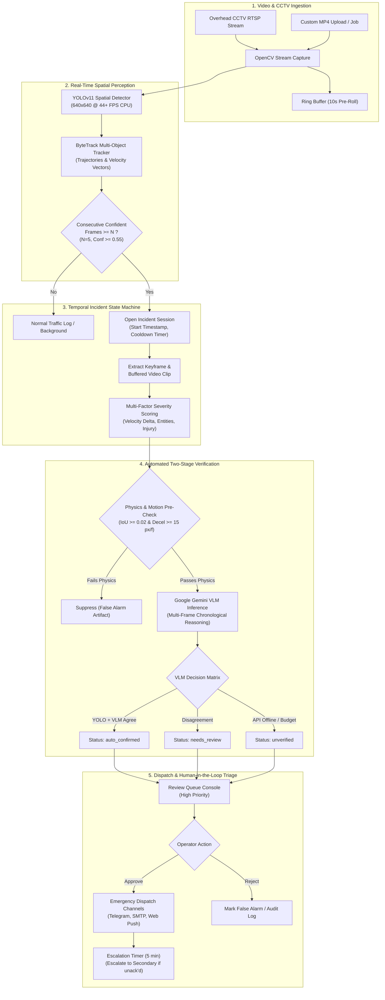
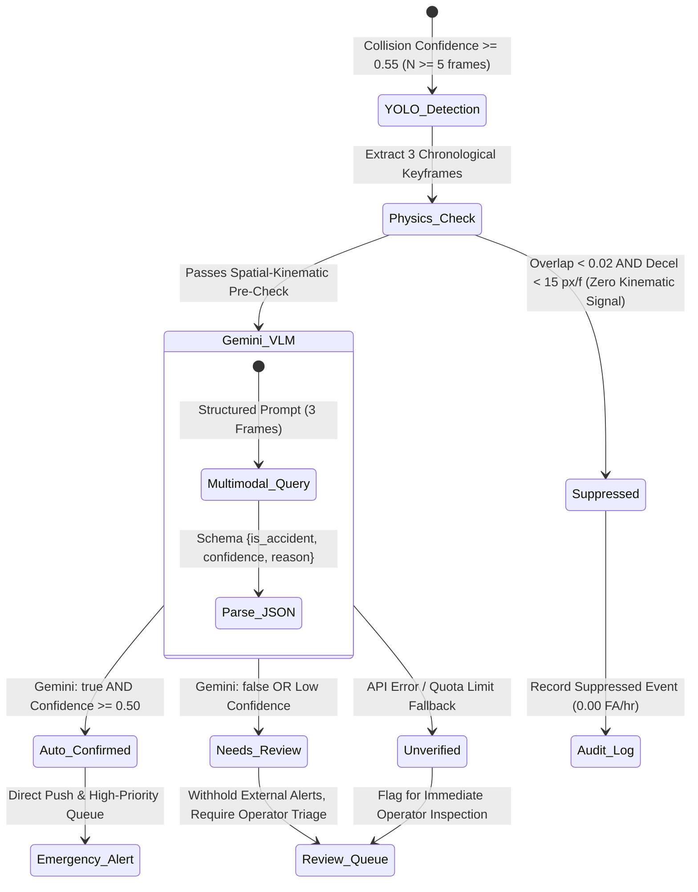
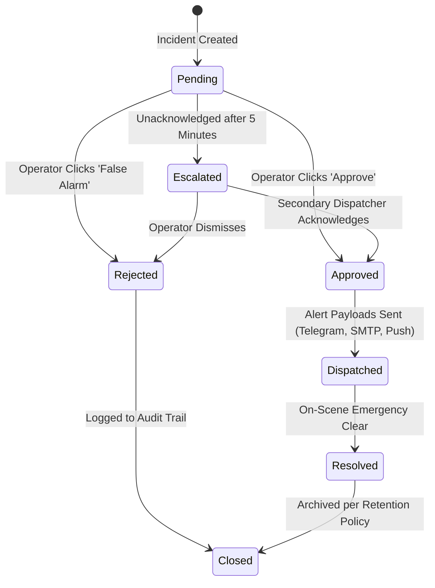
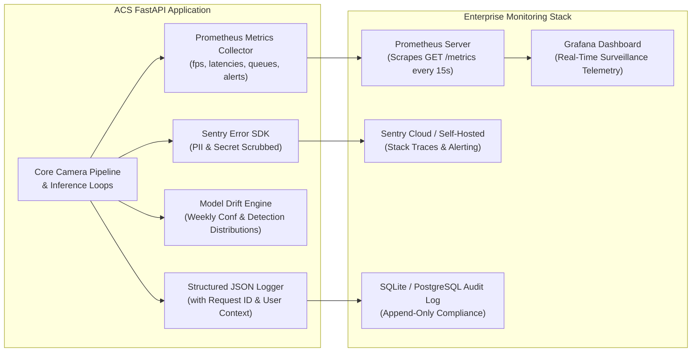
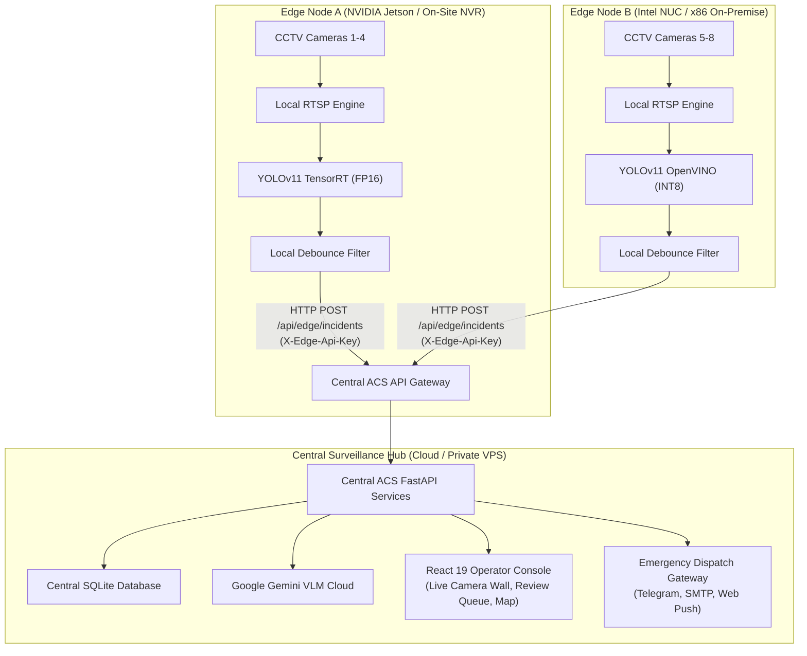

# Automated CCTV Accident Detection System (ACS)
# System Architecture Specification

This document details the architectural topology, data pipelines, state machines, and observability fabric of the **Automated CCTV Accident Detection System (ACS)**.

---

## 1. End-to-End Real-Time Detection & Verification Pipeline

---

## 2. Automated Tri-State Verification Decision Matrix

The verification layer uses a multi-factor decision matrix to balance false alarm suppression with crash recall:

---

## 3. Incident Lifecycle & Alert Escalation State Machine

Every incident transitions through an append-only, auditable lifecycle:

---

## 4. Observability & Telemetry Architecture

ACS instruments operational metrics, distributed logging, error capture, and model drift:

---

## 5. Distributed Edge-to-Cloud Hybrid Topology

For massive CCTV deployments, ACS supports distributed edge inference with centralized control room coordination:

