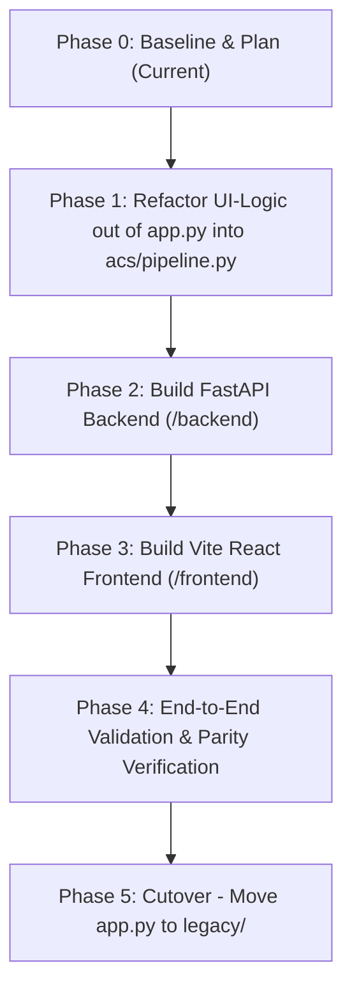

# Migration Plan: Streamlit to FastAPI + React Architecture

This document outlines the architectural migration plan for transitioning the **Automated CCTV Accident Detection System (ACS)** from its current monolithic Streamlit frontend ([`app.py`](file:///Users/shidharthkushwaha/Desktop/Acs/app.py)) to a modern, decoupled client-server architecture powered by a **FastAPI backend** and a **Vite + React (TypeScript) frontend**, while keeping the core [`acs/`](file:///Users/shidharthkushwaha/Desktop/Acs/acs) package as the shared, testable engine.

> **Guiding Principle**: [`app.py`](file:///Users/shidharthkushwaha/Desktop/Acs/app.py) remains fully functional throughout the migration. It will only be moved to [`legacy/`](file:///Users/shidharthkushwaha/Desktop/Acs/legacy) after the FastAPI backend and React frontend reach 100% feature parity and pass all integration tests.

---

## 1. Feature Mapping: Streamlit UI to REST/WebSocket Endpoints & React Components

Every UI element and workflow currently implemented across the Streamlit application is mapped below to its corresponding backend API endpoint (REST or WebSocket) and frontend React component.

### 1.1 Shell & Global Controls

| Streamlit Feature (`app.py`) | Protocol & Endpoint | HTTP Method / WS Type | React Page / Component | Description |
| :--- | :--- | :--- | :--- | :--- |
| **Language Switcher (EN / AR)** (`app.py:97-105`) | `GET /api/i18n/{lang}` | `GET` | `components/layout/LanguageToggle.tsx` | Switches active language, fetches translation dictionary, toggles `dir="rtl"` attribute and Arabic font classes on `<html>` document. |
| **RTL Layout Inversion** (`app.py:176-203`) | Client-side Context | N/A | `context/LanguageContext.tsx` | Conditionally applies RTL CSS direction across typography, sidebars, tabs, and modals while keeping video player canvas strictly LTR. |
| **Hardware Device Badge** (`app.py:146`) | `GET /api/system/status` | `GET` | `components/sidebar/DeviceBadge.tsx` | Displays active inference hardware (`CUDA:0`, `MPS`, `CPU`). |
| **Title & Subtitle Banner** (`app.py:623-624`) | Client-side i18n | N/A | `components/layout/HeaderBanner.tsx` | Displays system title and enterprise surveillance tagline. |

### 1.2 Sidebar Configuration (`render_sidebar`)

| Streamlit Feature (`app.py`) | Protocol & Endpoint | HTTP Method / WS Type | React Page / Component | Description |
| :--- | :--- | :--- | :--- | :--- |
| **Dynamic Model Scanner** (`app.py:47-57, 111-118`) | `GET /api/models`<br>`POST /api/models/active` | `GET`<br>`POST` | `components/sidebar/ModelSelector.tsx` | Scans workspace for `.pt` files, returns model list, and allows switching active YOLO checkpoint. |
| **Confidence Slider** (`app.py:121-128`) | `GET /api/config`<br>`PATCH /api/config` | `GET`<br>`PATCH` | `components/sidebar/ConfidenceSlider.tsx` | Slider (`0.10`–`0.95`, step `0.05`) to adjust detection threshold. |
| **Injury Model Toggle** (`app.py:130-143`) | `GET /api/models`<br>`PATCH /api/config` | `GET`<br>`PATCH` | `components/sidebar/InjuryToggle.tsx` | Checkbox to enable `injury.pt`; automatically disabled with warning badge if `injury.pt` is missing on disk. |
| **Emergency Alerts Toggle** (`app.py:151-155`) | `PATCH /api/alerts/config` | `PATCH` | `components/sidebar/AlertsToggle.tsx` | Global switch to enable or suppress automated Telegram/SMTP dispatch. |
| **Alerts Dry-Run Toggle** (`app.py:157-161`) | `PATCH /api/alerts/config` | `PATCH` | `components/sidebar/DryRunToggle.tsx` | Toggles simulation mode to test alerts without broadcasting to emergency dispatch channels. |
| **Send Test Alert Button** (`app.py:163-169`) | `POST /api/alerts/test` | `POST` | `components/sidebar/TestAlertButton.tsx` | Triggers a test alert across channels (Telegram/SMTP/Console) and returns delivery status per channel to render as a toast. |

### 1.3 Tab 1: Live Analysis View (`render_live_analysis_tab`)

| Streamlit Feature (`app.py`) | Protocol & Endpoint | HTTP Method / WS Type | React Page / Component | Description |
| :--- | :--- | :--- | :--- | :--- |
| **Video Source Radio** (`app.py:220-227`) | Client-side state | N/A | `pages/LiveAnalysis/SourceSelector.tsx` | Toggles between custom file upload mode and bundled demo sample. |
| **Sample Video Loader** (`app.py:230-236`) | `GET /api/videos/samples` | `GET` | `pages/LiveAnalysis/SamplePicker.tsx` | Lists available sample videos (`acc_ex.mp4`) and selects for playback. |
| **Video File Upload** (`app.py:238-247`) | `POST /api/videos/upload` | `POST` (Multipart) | `pages/LiveAnalysis/VideoUploader.tsx` | Drag-and-drop video upload (`.mp4`, `.avi`, `.mov`, `.mkv`), saves to `temp/`, returns `video_id`. |
| **Start / Stop Analysis** (`app.py:254`) | `POST /api/analysis/start`<br>`POST /api/analysis/{job_id}/stop` | `POST` | `pages/LiveAnalysis/AnalysisControls.tsx` | Initiates or terminates an inference session. |
| **Annotated Video Stream** (`app.py:325-327, 399-400`) | `WS /ws/analysis/{job_id}`<br>or `GET /api/stream/{job_id}` (MJPEG) | WebSocket / MJPEG | `pages/LiveAnalysis/AnnotatedPlayer.tsx` | Streams annotated video frames (base64 JPEG or canvas coordinates) with bounding boxes and ByteTrack IDs. |
| **Analysis Progress Bar** (`app.py:408-412`) | `WS /ws/analysis/{job_id}` | WS message (`progress`) | `pages/LiveAnalysis/ProgressBar.tsx` | Real-time progress bar with current frame, total frames, and percentage indicators. |
| **Live Incident Feed** (`app.py:296-311, 331-332`) | `WS /ws/analysis/{job_id}` | WS message (`incident_detected`) | `pages/LiveAnalysis/IncidentFeed.tsx`<br>`pages/LiveAnalysis/IncidentCard.tsx` | Dynamically updates a vertical feed of active/confirmed collisions with keyframe thumbnail, class, confidence, duration, and timestamp. |
| **Incident Detected Toast** (`app.py:334-343`) | Client-side Toast notification | WS message (`toast`) | `components/common/ToastContainer.tsx` | Non-blocking toast popup when an incident is officially recognized. |
| **Alert Dispatched Toast** (`app.py:373-381`) | Client-side Toast notification | WS message (`alert_sent`) | `components/common/ToastContainer.tsx` | Toast confirming Telegram / Email dispatch delivery status. |
| **Post-Run KPI Metrics** (`app.py:426-430`) | `WS /ws/analysis/{job_id}` (final) | WS message (`completed`) | `pages/LiveAnalysis/StatsScorecards.tsx` | Metric cards: Frames Analyzed, Real-time FPS, Total Incidents Found. |

### 1.4 Tab 2: Incident Reports View (`render_reports_tab`)

| Streamlit Feature (`app.py`) | Protocol & Endpoint | HTTP Method / WS Type | React Page / Component | Description |
| :--- | :--- | :--- | :--- | :--- |
| **Master Incidents Table** (`app.py:444-460`) | `GET /api/incidents` | `GET` (JSON) | `pages/Reports/IncidentsTable.tsx` | Interactive data table with sorting, pagination, and columns: `incident_id`, `start_timestamp`, `end_timestamp`, `class`, `max_confidence`, `image_path`. |
| **Class Filter Dropdown** (`app.py:452-456`) | `GET /api/incidents?class={class_name}` | `GET` | `pages/Reports/ClassFilter.tsx` | Filters master incident records by collision category. |
| **Export Master CSV** (`app.py:461-468`) | `GET /api/incidents/export/csv` | `GET` (File stream) | `pages/Reports/ExportCsvButton.tsx` | Downloads filtered or master records as `master_incidents_report.csv`. |
| **Incident Detail Cards / Modal** (`app.py:472-498`) | `GET /api/incidents/{incident_id}` | `GET` | `pages/Reports/IncidentDetailModal.tsx` | Detailed view displaying full timestamps, confidence score, and collision metadata. |
| **Keyframe Image Display** (`app.py:485-491`) | `GET /api/images/{filename}`<br>or static mount `/report_images/` | `GET` (Image/JPEG) | `pages/Reports/KeyframeViewer.tsx` | Displays high-resolution peak collision keyframe image. |
| **Generate Gemini Dispatch Report** (`app.py:504-515`) | `POST /api/incidents/{incident_id}/dispatch` | `POST` | `pages/Reports/GeminiDispatchCard.tsx` | Calls Google Gemini multimodal API with keyframe image + surrounding frames; returns structured JSON and rendered markdown text. |
| **Rendered Dispatch Text Display** (`app.py:516-523`) | Client-side Markdown viewer | N/A | `pages/Reports/DispatchTextViewer.tsx` | Displays formatted 5–8 line dispatch text in English or Arabic inside a syntax-highlighted code container. |
| **Export Incident PDF** (`app.py:527-544`) | `GET /api/incidents/{incident_id}/export/pdf?lang={lang}` | `GET` (application/pdf) | `pages/Reports/DownloadPdfButton.tsx` | Generates official PDF document with keyframe and dispatch assessment; downloads `{incident_id}_report.pdf`. |
| **Manual Dispatch Alert Button** (`app.py:546-556`) | `POST /api/incidents/{incident_id}/send-alert` | `POST` | `pages/Reports/SendAlertButton.tsx` | Dispatches incident notification and keyframe manually to Telegram and SMTP with instant delivery feedback. |

### 1.5 Tab 3: About View (`render_about_tab`)

| Streamlit Feature (`app.py`) | Protocol & Endpoint | HTTP Method / WS Type | React Page / Component | Description |
| :--- | :--- | :--- | :--- | :--- |
| **System Description & Features** (`app.py:567-577`) | `GET /api/system/about` | `GET` | `pages/About/AboutOverview.tsx` | Renders system overview, mission, and the 5 core architecture capabilities. |
| **Supported Classes Grid** (`app.py:579-597`) | `GET /api/system/classes` | `GET` | `pages/About/ClassDirectoryGrid.tsx` | 2-column visual grid showing all 10 supported classes (normal traffic vs. accidents) with bilingual names and emojis. |
| **Tech Stack Specifications** (`app.py:599-609`) | `GET /api/system/about` | `GET` | `pages/About/TechStackSpecs.tsx` | Lists Computer Vision, Multimodal LLM, and runtime specs. |

---

## 2. Core `acs/` Functions & Signatures Used by the API

The FastAPI service layer will directly invoke the following functions and classes from the [`acs/`](file:///Users/shidharthkushwaha/Desktop/Acs/acs) package:

### 2.1 Detection & Tracking ([`acs/detector.py`](file:///Users/shidharthkushwaha/Desktop/Acs/acs/detector.py))

```python
def load_model(weights_path: str) -> ultralytics.YOLO
```
* **Purpose**: Loads and validates the Ultralytics YOLO model from `.pt` weights.

```python
class AccidentDetector:
    def __init__(
        self,
        model_path: Optional[str] = None,
        injury_model_path: Optional[str] = None,
        confidence_threshold: Optional[float] = None,
        injury_confidence_threshold: Optional[float] = None,
        device: Optional[str] = None,
        accident_classes: Optional[Set[str]] = None,
    )

    def track_frame(
        self,
        frame: np.ndarray,
        resize_width: int = 1080,
    ) -> DetectionResult

    def predict_frame(
        self,
        frame: np.ndarray,
        resize_width: int = 1080,
        track: bool = False,
    ) -> DetectionResult
```
* **Purpose**: Executes YOLO inference and ByteTrack object tracking on individual frames; returns bounding boxes, tracking IDs, annotated image, and accident flags.

```python
class AccidentEventManager:
    def __init__(
        self,
        consecutive_frames_threshold: int = 5,
        timeout_seconds: float = 3.0,
        cooldown_seconds: float = 10.0,
        confidence_threshold: Optional[float] = None,
        accident_classes: Optional[Set[str]] = None,
        output_dir: Optional[str] = None,
        reports_dir: Optional[str] = None,
        csv_filename: str = "incidents.csv",
        auto_save: bool = True,
    )

    def update(
        self,
        detection_result: DetectionResult,
        frame: Optional[np.ndarray] = None,
        timestamp: Optional[float] = None,
    ) -> Optional[AccidentIncident]

    def end_active_incident(
        self,
        timestamp: Optional[float] = None,
    ) -> Optional[AccidentIncident]

    def reset(self) -> None
```
* **Purpose**: State machine that manages accident lifecycle (5-frame debounce, keyframe selection, 3s timeout, 10s cooldown, artifact persistence).

### 2.2 Reporting & Artifacts ([`acs/reporter.py`](file:///Users/shidharthkushwaha/Desktop/Acs/acs/reporter.py))

```python
def read_incidents_csv(
    reports_dir: Optional[str] = None,
    csv_filename: str = "incidents.csv",
) -> pd.DataFrame
```
* **Purpose**: Reads all historical incident records from disk into a DataFrame for API serialization.

```python
def generate_report_pdf(
    incident_id: str,
    class_name: str,
    start_timestamp: str,
    end_timestamp: str,
    max_confidence: float,
    image_path: Optional[str] = None,
    dispatch_text: Optional[str] = None,
    lang: str = "en",
) -> bytes
```
* **Purpose**: Compiles vector PDF incident report with keyframe image and Gemini dispatch assessment; returns raw bytes for streaming.

```python
def save_keyframe(
    frame: np.ndarray,
    output_dir: Optional[str] = None,
    timestamp: Optional[str] = None,
) -> Tuple[str, str]
```
* **Purpose**: Persists a frame to disk as a JPEG image and returns `(filename, full_path)`.

```python
def list_reports(
    reports_dir: Optional[str] = None,
    report_images_dir: Optional[str] = None,
) -> List[ReportRecord]
```
* **Purpose**: Discovers and parses individual historical report CSV files.

### 2.3 Multimodal LLM Dispatch ([`acs/llm.py`](file:///Users/shidharthkushwaha/Desktop/Acs/acs/llm.py))

```python
def generate_dispatch_report(
    image_path: Union[str, List[str]],
    detections: Optional[Any] = None,
    timestamp: Optional[str] = None,
    lang: str = "en",
    api_key: Optional[str] = None,
    model_name: Optional[str] = None,
    timeout: Optional[float] = None,
    max_retries: Optional[int] = None,
    additional_image_paths: Optional[List[str]] = None,
) -> Dict[str, Any]
```
* **Purpose**: Calls Google Gemini API with multi-frame context to extract structured dispatch JSON schema with exponential backoff and rule-based template fallback.

```python
def render_dispatch_text(
    report_data: Dict[str, Any],
    lang: str = "en",
) -> str
```
* **Purpose**: Converts structured dispatch dictionary into a 5–8 line localized dispatch message for display and PDF embedding.

### 2.4 Emergency Notifications ([`acs/alerts.py`](file:///Users/shidharthkushwaha/Desktop/Acs/acs/alerts.py))

```python
def send_incident_alert(
    incident: Any,
    report_text: str,
    image_path: Optional[str] = None,
    channels: Optional[List[str]] = None,
    dry_run: bool = False,
) -> Dict[str, bool]
```
* **Purpose**: Dispatches confirmed collision alert with keyframe attachment across configured channels (Telegram, SMTP, Console).

```python
def send_test_alert(
    dry_run: bool = False,
    lang: str = "en",
    channels: Optional[List[str]] = None,
) -> Dict[str, bool]
```
* **Purpose**: Dispatches synthetic test alert to verify Telegram and SMTP connectivity.

### 2.5 Internationalization ([`acs/i18n.py`](file:///Users/shidharthkushwaha/Desktop/Acs/acs/i18n.py))

```python
def t(key: str, lang: str = "en", **kwargs: Any) -> str
def translate_class_name(class_name: str, lang: str = "en") -> str
```
* **Constants**: `UI_STRINGS: Dict[str, Dict[str, str]]`, `CLASS_TRANSLATIONS: Dict[str, str]`.
* **Purpose**: Provides full translation dictionary and class translations to expose to the frontend.

### 2.6 Configuration ([`acs/config.py`](file:///Users/shidharthkushwaha/Desktop/Acs/acs/config.py))

```python
def auto_detect_device() -> str
class AppConfig: ...
config: AppConfig
```
* **Constants**: `CLASS_NAMES: List[str]`, `ACCIDENT_CLASSES: Set[str]`.
* **Purpose**: System constants, directory validation, hardware detection, and environment defaults.

---

## 3. UI-Logic Separation: Code in `app.py` to Move into `acs/` First

Before implementing the API layer, four pieces of business logic currently embedded inside [`app.py`](file:///Users/shidharthkushwaha/Desktop/Acs/app.py) must be moved into the [`acs/`](file:///Users/shidharthkushwaha/Desktop/Acs/acs) package. This ensures both Streamlit and FastAPI can import them without code duplication:

### 3.1 Model File Discovery (`app.py:47-57`)
* **Current location**: [`scan_model_weights()`](file:///Users/shidharthkushwaha/Desktop/Acs/app.py#L47-L57) in [`app.py`](file:///Users/shidharthkushwaha/Desktop/Acs/app.py).
* **Issue**: Directly scans `os.listdir(".")` for `.pt` files inside the UI script.
* **Target relocation**: Move to [`acs/config.py`](file:///Users/shidharthkushwaha/Desktop/Acs/acs/config.py) or [`acs/detector.py`](file:///Users/shidharthkushwaha/Desktop/Acs/acs/detector.py) as:
  ```python
  def scan_available_models(directory: str = ".") -> List[str]:
      """Scans directory for available YOLO weights (.pt files)."""
  ```
* **Streamlit refactor**: In [`app.py`](file:///Users/shidharthkushwaha/Desktop/Acs/app.py), replace `scan_model_weights()` with an import: `from acs.config import scan_available_models`.

### 3.2 Video Stream Processing Pipeline Loop (`app.py:259-423`)
* **Current location**: Nested directly inside `render_live_analysis_tab()` in [`app.py`](file:///Users/shidharthkushwaha/Desktop/Acs/app.py).
* **Issue**: Contains video reading (`cv2.VideoCapture`), frame scaling, FPS timing, tracking execution, and progress calculation. A FastAPI WebSocket server cannot reuse this without extracting it from the Streamlit UI loop.
* **Target relocation**: Create [`acs/pipeline.py`](file:///Users/shidharthkushwaha/Desktop/Acs/acs/pipeline.py) providing a reusable generator / pipeline runner:
  ```python
  class VideoAnalysisPipeline:
      def __init__(self, detector: AccidentDetector, event_manager: AccidentEventManager):
          ...
      def process_video_stream(
          self,
          video_path: str,
          yield_annotated_frames: bool = True,
      ) -> Generator[Dict[str, Any], None, Dict[str, Any]]:
          """Yields per-frame progress, detections, and alerts, then returns final stats."""
  ```
* **Streamlit refactor**: [`app.py`](file:///Users/shidharthkushwaha/Desktop/Acs/app.py) consumes `VideoAnalysisPipeline.process_video_stream()`, maintaining identical UI output while decoupling the execution loop.

### 3.3 Incident Closure & Automated Dispatch Orchestration (`app.py:329-385`)
* **Current location**: `handle_incident_closure()` defined inside `render_live_analysis_tab()`.
* **Issue**: Glues incident closure, Gemini dispatch generation, and alert sending into one closure function.
* **Target relocation**: Move to [`acs/pipeline.py`](file:///Users/shidharthkushwaha/Desktop/Acs/acs/pipeline.py) or add as a callback hook to [`AccidentEventManager`](file:///Users/shidharthkushwaha/Desktop/Acs/acs/detector.py#L260):
  ```python
  def handle_incident_lifecycle_event(
      incident: AccidentIncident,
      lang: str = "en",
      enable_alerts: bool = True,
      dry_run: bool = False,
  ) -> Dict[str, Any]:
      """Generates dispatch report and transmits alerts for a closed incident."""
  ```

### 3.4 Media File Utilities (`app.py:243-246`)
* **Current location**: Writing uploaded video bytes to `os.path.join(config.temp_dir, "input_analysis.mp4")`.
* **Target relocation**: Move helper to [`acs/reporter.py`](file:///Users/shidharthkushwaha/Desktop/Acs/acs/reporter.py):
  ```python
  def save_temp_video(file_bytes: bytes, filename: str) -> str:
      """Saves an incoming video stream to temp storage and returns the validated path."""
  ```

---

## 4. Proposed Repository Layout

```
Acs/
├── acs/                                  # CORE SHARED PYTHON PACKAGE (Untouched API contract)
│   ├── __init__.py
│   ├── alerts.py                         # Telegram, SMTP, and Console alert backends
│   ├── config.py                         # AppConfig, device detection, scan_available_models()
│   ├── detector.py                       # YOLO inference, ByteTrack, AccidentEventManager
│   ├── i18n.py                           # English / Arabic UI catalog & class translations
│   ├── llm.py                            # Gemini multimodal dispatch analysis & fallbacks
│   ├── pipeline.py                       # [NEW] Extracted VideoAnalysisPipeline & orchestration
│   └── reporter.py                       # CSV logging, PDF generation, keyframe persistence
│
├── backend/                              # FASTAPI BACKEND SERVICE
│   ├── app/
│   │   ├── __init__.py
│   │   ├── main.py                       # FastAPI entrypoint, CORS, routers inclusion, static mounts
│   │   ├── dependencies.py               # Singleton detector caching & config injection
│   │   ├── routers/
│   │   │   ├── __init__.py
│   │   │   ├── alerts.py                 # POST /api/alerts/test, PATCH /api/alerts/config
│   │   │   ├── analysis.py               # Video upload, WS live stream, stop analysis
│   │   │   ├── config.py                 # GET/PATCH /api/config
│   │   │   ├── i18n.py                   # GET /api/i18n/{lang}
│   │   │   ├── incidents.py              # GET /api/incidents, CSV/PDF export, Gemini dispatch
│   │   │   ├── models.py                 # GET/POST /api/models (switch active weights)
│   │   │   └── system.py                 # GET /api/system/status, /about, /classes
│   │   ├── schemas/                      # Pydantic v2 API DTO schemas
│   │   │   ├── alerts.py
│   │   │   ├── analysis.py
│   │   │   ├── config.py
│   │   │   └── incident.py
│   │   └── services/
│   │       ├── __init__.py
│   │       └── analysis_session.py       # WebSocket broadcaster coordinating VideoAnalysisPipeline
│   ├── requirements.txt                  # fastapi, uvicorn[standard], websockets, python-multipart
│   └── run.py                            # Local uvicorn development launcher
│
├── frontend/                             # VITE + REACT + TYPESCRIPT FRONTEND
│   ├── package.json
│   ├── vite.config.ts
│   ├── tsconfig.json
│   ├── index.html
│   └── src/
│       ├── main.tsx                      # React root
│       ├── App.tsx                       # Main shell, sidebar, tabs routing
│       ├── api/                          # HTTP and WebSocket API clients
│       │   ├── alerts.ts
│       │   ├── analysis.ts
│       │   ├── client.ts                 # Axios / fetch instance with base URL
│       │   ├── incidents.ts
│       │   ├── models.ts
│       │   └── websocket.ts              # Robust WebSocket client with auto-reconnect
│       ├── components/
│       │   ├── common/                   # ToastContainer, Modal, Badge, Button
│       │   ├── layout/                   # HeaderBanner, NavigationTabs, LanguageToggle
│       │   └── sidebar/                  # ModelSelector, ConfidenceSlider, InjuryToggle, AlertSettings
│       ├── context/
│       │   ├── AnalysisContext.tsx       # Live stream state, progress, incident notifications
│       │   └── LanguageContext.tsx       # Active lang ('en'|'ar'), RTL toggle, i18n strings
│       ├── pages/
│       │   ├── About/                    # AboutOverview, ClassDirectoryGrid, TechStackSpecs
│       │   ├── LiveAnalysis/             # VideoPlayer, SourceSelector, IncidentFeed, StatsScorecards
│       │   └── Reports/                  # IncidentsTable, GeminiDispatchCard, PDFExportButton
│       └── styles/
│           ├── index.css                 # Global CSS tokens, dark mode palette
│           └── rtl.css                   # Right-to-Left Arabic typography and layout rules
│
├── docs/
│   ├── MIGRATION_PLAN.md                 # This document
│   └── API_SPECIFICATION.md              # Detailed OpenAPI & WebSocket schemas
│
├── app.py                                # ACTIVE Streamlit application (Kept working!)
├── legacy/                               # [Target for app.py only at final cutover stage]
├── tests/                                # Full pytest test suite (All 55 existing tests passing)
├── reports/                              # Persisted CSV reports directory
├── report_images/                        # Persisted collision keyframe images
├── temp/                                 # Scratch / upload buffer directory
├── best.pt                               # Recommended production YOLO weights
├── acc_ex.mp4                            # Bundled demonstration video
├── pyproject.toml
└── requirements.txt
```

---

## 5. Step-by-Step Migration Phases



1. **Phase 1: Refactor UI-Logic into `acs/pipeline.py`**
   - Extract `scan_available_models()` and `VideoAnalysisPipeline` into `acs/`.
   - Update [`app.py`](file:///Users/shidharthkushwaha/Desktop/Acs/app.py) to import these functions.
   - Run `pytest tests/` and verify that the 55 tests pass and [`app.py`](file:///Users/shidharthkushwaha/Desktop/Acs/app.py) behaves identically.

2. **Phase 2: Develop FastAPI Backend (`backend/`)**
   - Create FastAPI app with REST routers and WebSocket stream endpoint.
   - Mount `/report_images` and `/reports` as static assets for keyframe retrieval.
   - Add backend unit and integration tests using `httpx.AsyncClient` and `TestClient`.

3. **Phase 3: Develop Vite + React Frontend (`frontend/`)**
   - Scaffold Vite React TypeScript project.
   - Implement `LanguageContext` supporting English and Arabic with instant RTL CSS layout flipping.
   - Build UI components matching Streamlit's layout: Sidebar controls, Live Analysis with WebSocket video streaming and incident feed, Incident Reports table with Gemini dispatch cards and PDF download, and About directory.

4. **Phase 4: End-to-End Validation & Parity Testing**
   - Validate live video processing on `acc_ex.mp4` via WebSocket.
   - Confirm incident debouncing, keyframe generation, CSV row appending, and alert dispatches.
   - Test PDF download and Gemini dispatch report generation in both English and Arabic.

5. **Phase 5: Cutover & Cleanup**
   - Move [`app.py`](file:///Users/shidharthkushwaha/Desktop/Acs/app.py) into [`legacy/app_streamlit.py`](file:///Users/shidharthkushwaha/Desktop/Acs/legacy).
   - Update [`README.md`](file:///Users/shidharthkushwaha/Desktop/Acs/README.md) with FastAPI and Vite startup commands.
