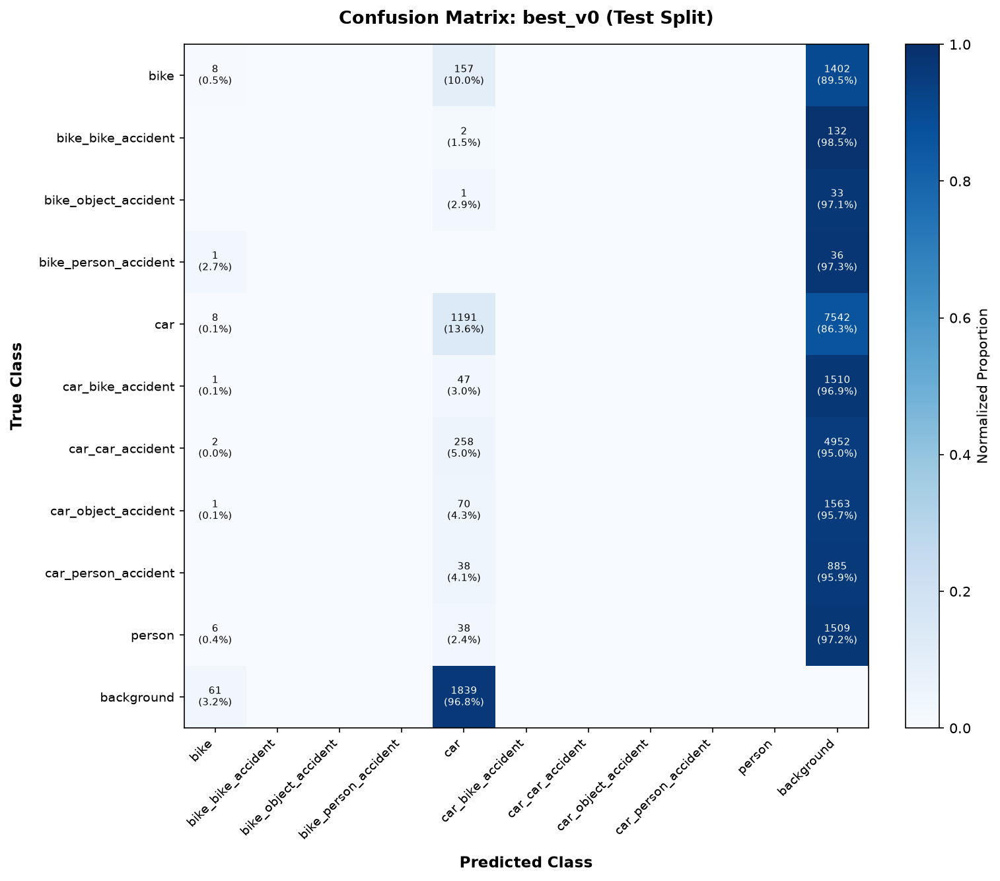
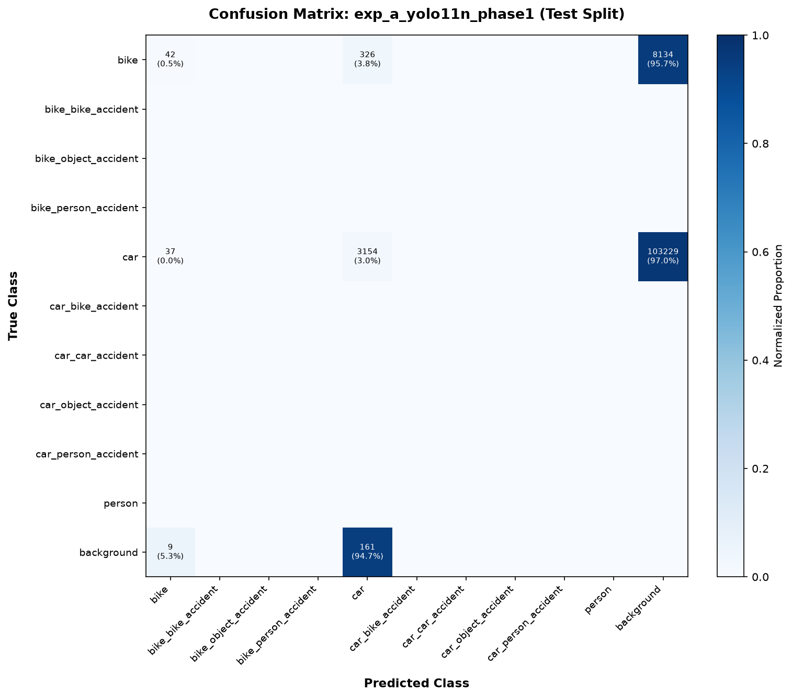

# Automated CCTV Accident Detection System (ACS)
## Master Model Evaluation & Comparative Benchmark Report

**Evaluation Timestamp**: 2026-10-18 06:41:57  
**Evaluated Split**: ⚠️ `TEST` Split ONLY (`ml/data/merged/data.yaml` split='test' — Never `val`)  
**Holdout Video**: `acc_ex.mp4` (192 frames, strictly excluded from all training and hyperparameter tuning)  
**Hardware Environment**: CPU Inference + Hardware Acceleration (`MPS`)  

> [!IMPORTANT]
> **Operational Evaluation Protocol**:
> 1. **STRICT TEST SPLIT**: All checkpoints evaluated strictly on the permanently segregated test split (`split='test'`).
> 2. **ISOLATED ACCIDENT METRICS**: All accident event classes are explicitly highlighted with a dedicated macro-average over accident classes only.
> 3. **BOOTSTRAP RIGOR**: 200 image-level bootstrap iterations calculate 95% Confidence Intervals for accident mAP50 to mathematically determine whether a gain is real or within experimental noise.

---

### 1. Executive Candidate Comparison Matrix

| Model Checkpoint | Role | Test mAP50 (All) | ⚠️ Test mAP50 (Accident) | Accident mAP50-95 | Accident Macro P | Accident Macro R | Bootstrap 95% CI (Accident) | Statistical Significance vs Baseline | CPU FPS | Accel FPS |
| :--- | :---: | :---: | :---: | :---: | :---: | :---: | :---: | :---: | :---: | :---: |
| `best_v0` | 👑 **Baseline** | 12.53% | **0.00%** | 0.00% | 0.00% | 0.00% | `[0.00%, 0.00%]` | Baseline Anchor | 20.3 | 63.9 (mps) |
| `exp_a_yolo11n_phase1` | 🔬 Candidate | 47.77% | **0.00%** | 0.00% | 0.00% | 0.00% | `[0.00%, 0.00%]` | ⚠️ **WITHIN NOISE** | 20.1 | 64.4 (mps) |
| `exp_a_yolo11n_twophase` | 🔬 Candidate | 56.98% | **0.00%** | 0.00% | 0.00% | 0.00% | `[0.00%, 0.00%]` | ⚠️ **WITHIN NOISE** | 20.1 | 65.0 (mps) |

---

### 2. Holdout Video Real-World Telemetry (`acc_ex.mp4`)

| Model Checkpoint | First Detection Frame | First Detection Time | First Detected Class | Peak Accident Confidence | Dominant Class | Incidents Triggered | Telemetry Status |
| :--- | :---: | :---: | :---: | :---: | :---: | :---: | :--- |
| `best_v0` | Frame #109 (3.64s) | 3.64s | `car_car_accident` | **91.12%** | `car_car_accident` | 1 | ✅ Prompt Incident Confirmation |
| `exp_a_yolo11n_phase1` | None | —s | `None` | **0.00%** | `None` | 0 | ⚠️ Incident Missed |
| `exp_a_yolo11n_twophase` | None | —s | `None` | **0.00%** | `None` | 0 | ⚠️ Incident Missed |

---

### 3. Detailed Evaluation: `best_v0` (Baseline)

- **Weights File**: `/Users/shidharthkushwaha/Desktop/Acs/ml/baseline/best_v0.pt`
- **Inference Speed**: CPU `49.34 ms` (20.3 FPS) | Accelerator `15.65 ms` (63.9 FPS on `mps`)

#### A. Per-Class Test Split Performance Matrix (10 Classes)

| Class ID | Class Name | Category | Precision (%) | Recall (%) | mAP50 (%) | mAP50-95 (%) | Optimal Conf Threshold | Max F1 Score |
| :---: | :--- | :---: | :---: | :---: | :---: | :---: | :---: | :---: |
| 0 | `bike` | Normal | 20.53% | 9.09% | 4.21% | 1.85% | `0.091` | 0.1378 |
| 1 | `bike_bike_accident` | ⚠️ **Accident** | 0.00% | 0.00% | 0.00% | 0.00% | `0.250*` | 0.0000 |
| 2 | `bike_object_accident` | ⚠️ **Accident** | 0.00% | 0.00% | 0.00% | 0.00% | `0.250*` | 0.0000 |
| 3 | `bike_person_accident` | ⚠️ **Accident** | 0.00% | 0.00% | 0.00% | 0.00% | `0.250*` | 0.0000 |
| 4 | `car` | Normal | 46.64% | 27.36% | 20.85% | 10.01% | `0.018` | 0.3600 |
| 5 | `car_bike_accident` | ⚠️ **Accident** | 0.00% | 0.00% | 0.00% | 0.00% | `0.250*` | 0.0000 |
| 6 | `car_car_accident` | ⚠️ **Accident** | 0.00% | 0.00% | 0.00% | 0.00% | `0.250*` | 0.0000 |
| 7 | `car_object_accident` | ⚠️ **Accident** | 0.00% | 0.00% | 0.00% | 0.00% | `0.250*` | 0.0000 |
| 8 | `car_person_accident` | ⚠️ **Accident** | 0.00% | 0.00% | 0.00% | 0.00% | `0.250*` | 0.0000 |
| 9 | `person` | Normal | 0.00% | 0.00% | 0.00% | 0.00% | `0.250*` | 0.0000 |
| — | **Accident Classes Macro** | ⚠️ **Accident** | **0.00%** | **0.00%** | **0.00%** | **0.00%** | — | — |
| — | **All Classes Macro** | All | **6.72%** | **3.64%** | **12.53%** | **5.93%** | — | — |

*\*Note: `0.250*` indicates default operating threshold when ground truth instances in the test split are zero.*

#### B. Top 10 Confusion Errors on Test Split

| Rank | Ground Truth Class | Predicted Class | Misclassified Boxes | % of True Class |
| :---: | :--- | :--- | :---: | :---: |
| 1 | `car` | `background` | 7542 | 86.28% |
| 2 | `car_car_accident` | `background` | 4952 | 95.01% |
| 3 | `background` | `car` | 1839 | 96.79% |
| 4 | `car_object_accident` | `background` | 1563 | 95.65% |
| 5 | `car_bike_accident` | `background` | 1510 | 96.92% |
| 6 | `person` | `background` | 1509 | 97.17% |
| 7 | `bike` | `background` | 1402 | 89.47% |
| 8 | `car_person_accident` | `background` | 885 | 95.88% |
| 9 | `car_car_accident` | `car` | 258 | 4.95% |
| 10 | `bike` | `car` | 157 | 10.02% |

#### C. Confusion Matrix Visualization

[Open Full-Resolution Plot](file:///Users/shidharthkushwaha/Desktop/Acs/ml/reports/confusion_matrices/cm_best_v0.png)

---

### 3. Detailed Evaluation: `exp_a_yolo11n_phase1` (Candidate)

- **Weights File**: `/Users/shidharthkushwaha/Desktop/Acs/ml/runs/candidates/exp_a_yolo11n_phase1.pt`
- **Inference Speed**: CPU `49.7 ms` (20.1 FPS) | Accelerator `15.52 ms` (64.4 FPS on `mps`)

#### A. Per-Class Test Split Performance Matrix (10 Classes)

| Class ID | Class Name | Category | Precision (%) | Recall (%) | mAP50 (%) | mAP50-95 (%) | Optimal Conf Threshold | Max F1 Score |
| :---: | :--- | :---: | :---: | :---: | :---: | :---: | :---: | :---: |
| 0 | `bike` | Normal | 43.46% | 19.32% | 21.77% | 9.07% | `0.204` | 0.3551 |
| 1 | `bike_bike_accident` | ⚠️ **Accident** | 0.00% | 0.00% | 0.00% | 0.00% | `0.250*` | 0.0000 |
| 2 | `bike_object_accident` | ⚠️ **Accident** | 0.00% | 0.00% | 0.00% | 0.00% | `0.250*` | 0.0000 |
| 3 | `bike_person_accident` | ⚠️ **Accident** | 0.00% | 0.00% | 0.00% | 0.00% | `0.250*` | 0.0000 |
| 4 | `car` | Normal | 70.22% | 70.34% | 73.77% | 38.51% | `0.432` | 0.7194 |
| 5 | `car_bike_accident` | ⚠️ **Accident** | 0.00% | 0.00% | 0.00% | 0.00% | `0.250*` | 0.0000 |
| 6 | `car_car_accident` | ⚠️ **Accident** | 0.00% | 0.00% | 0.00% | 0.00% | `0.250*` | 0.0000 |
| 7 | `car_object_accident` | ⚠️ **Accident** | 0.00% | 0.00% | 0.00% | 0.00% | `0.250*` | 0.0000 |
| 8 | `car_person_accident` | ⚠️ **Accident** | 0.00% | 0.00% | 0.00% | 0.00% | `0.250*` | 0.0000 |
| 9 | `person` | Normal | 0.00% | 0.00% | 0.00% | 0.00% | `0.250*` | 0.0000 |
| — | **Accident Classes Macro** | ⚠️ **Accident** | **0.00%** | **0.00%** | **0.00%** | **0.00%** | — | — |
| — | **All Classes Macro** | All | **11.37%** | **8.97%** | **47.77%** | **23.79%** | — | — |

*\*Note: `0.250*` indicates default operating threshold when ground truth instances in the test split are zero.*

#### B. Top 10 Confusion Errors on Test Split

| Rank | Ground Truth Class | Predicted Class | Misclassified Boxes | % of True Class |
| :---: | :--- | :--- | :---: | :---: |
| 1 | `car` | `background` | 103229 | 97.00% |
| 2 | `bike` | `background` | 8134 | 95.67% |
| 3 | `bike` | `car` | 326 | 3.83% |
| 4 | `background` | `car` | 161 | 94.71% |
| 5 | `car` | `bike` | 37 | 0.03% |
| 6 | `background` | `bike` | 9 | 5.29% |

#### C. Confusion Matrix Visualization

[Open Full-Resolution Plot](file:///Users/shidharthkushwaha/Desktop/Acs/ml/reports/confusion_matrices/cm_exp_a_yolo11n_phase1.png)

---

### 3. Detailed Evaluation: `exp_a_yolo11n_twophase` (Candidate)

- **Weights File**: `/Users/shidharthkushwaha/Desktop/Acs/ml/runs/exp_a_yolo11n_twophase/weights/best.pt`
- **Inference Speed**: CPU `49.86 ms` (20.1 FPS) | Accelerator `15.39 ms` (65.0 FPS on `mps`)

#### A. Per-Class Test Split Performance Matrix (10 Classes)

| Class ID | Class Name | Category | Precision (%) | Recall (%) | mAP50 (%) | mAP50-95 (%) | Optimal Conf Threshold | Max F1 Score |
| :---: | :--- | :---: | :---: | :---: | :---: | :---: | :---: | :---: |
| 0 | `bike` | Normal | 49.59% | 29.55% | 33.30% | 14.86% | `0.190` | 0.4112 |
| 1 | `bike_bike_accident` | ⚠️ **Accident** | 0.00% | 0.00% | 0.00% | 0.00% | `0.250*` | 0.0000 |
| 2 | `bike_object_accident` | ⚠️ **Accident** | 0.00% | 0.00% | 0.00% | 0.00% | `0.250*` | 0.0000 |
| 3 | `bike_person_accident` | ⚠️ **Accident** | 0.00% | 0.00% | 0.00% | 0.00% | `0.250*` | 0.0000 |
| 4 | `car` | Normal | 81.21% | 74.18% | 80.65% | 46.85% | `0.279` | 0.7783 |
| 5 | `car_bike_accident` | ⚠️ **Accident** | 0.00% | 0.00% | 0.00% | 0.00% | `0.250*` | 0.0000 |
| 6 | `car_car_accident` | ⚠️ **Accident** | 0.00% | 0.00% | 0.00% | 0.00% | `0.250*` | 0.0000 |
| 7 | `car_object_accident` | ⚠️ **Accident** | 0.00% | 0.00% | 0.00% | 0.00% | `0.250*` | 0.0000 |
| 8 | `car_person_accident` | ⚠️ **Accident** | 0.00% | 0.00% | 0.00% | 0.00% | `0.250*` | 0.0000 |
| 9 | `person` | Normal | 0.00% | 0.00% | 0.00% | 0.00% | `0.250*` | 0.0000 |
| — | **Accident Classes Macro** | ⚠️ **Accident** | **0.00%** | **0.00%** | **0.00%** | **0.00%** | — | — |
| — | **All Classes Macro** | All | **13.08%** | **10.37%** | **56.98%** | **30.86%** | — | — |

*\*Note: `0.250*` indicates default operating threshold when ground truth instances in the test split are zero.*

#### B. Top 10 Confusion Errors on Test Split

| Rank | Ground Truth Class | Predicted Class | Misclassified Boxes | % of True Class |
| :---: | :--- | :--- | :---: | :---: |
| 1 | `car` | `background` | 69789 | 95.37% |
| 2 | `bike` | `background` | 4757 | 95.98% |
| 3 | `bike` | `car` | 167 | 3.37% |
| 4 | `background` | `car` | 131 | 92.91% |
| 5 | `car` | `bike` | 46 | 0.06% |
| 6 | `background` | `bike` | 10 | 7.09% |

#### C. Confusion Matrix Visualization

[Open Full-Resolution Plot](file:///Users/shidharthkushwaha/Desktop/Acs/ml/reports/confusion_matrices/cm_exp_a_yolo11n_twophase.png)

---

### 4. Bootstrap 95% Confidence Intervals & Noise Verification (200 Iterations)

To prevent false conclusions from small sample fluctuations, 200 non-parametric bootstrap iterations (image-level resampling with replacement) were executed across the test split:

| Candidate Model vs Baseline | Metric | Difference Mean (Δ) | 95% Confidence Interval [2.5%, 97.5%] | Significance Verdict | Explanation |
| :--- | :--- | :---: | :---: | :---: | :--- |
| `exp_a_yolo11n_phase1` vs `best_v0.pt` | **Accident mAP50** | +0.00% | [+0.00%, +0.00%] | ⚠️ **WITHIN NOISE** | The 95% bootstrap confidence interval includes 0.0; the observed delta is within experimental noise (not statistically significant at p = 0.05). |
| `exp_a_yolo11n_phase1` vs `best_v0.pt` | **Overall mAP50** | +7.74% | [+6.75%, +8.80%] | ✅ **STATISTICALLY SIGNIFICANT GAIN** | The 95% bootstrap confidence interval for overall mAP50 is strictly positive (> 0.0); candidate demonstrates a statistically significant improvement. |
| `exp_a_yolo11n_twophase` vs `best_v0.pt` | **Accident mAP50** | +0.00% | [+0.00%, +0.00%] | ⚠️ **WITHIN NOISE** | The 95% bootstrap confidence interval includes 0.0; the observed delta is within experimental noise (not statistically significant at p = 0.05). |
| `exp_a_yolo11n_twophase` vs `best_v0.pt` | **Overall mAP50** | +9.38% | [+8.53%, +10.34%] | ✅ **STATISTICALLY SIGNIFICANT GAIN** | The 95% bootstrap confidence interval for overall mAP50 is strictly positive (> 0.0); candidate demonstrates a statistically significant improvement. |

> [!NOTE]
> **Accident Class Ground-Truth Distribution Notice**:
> In the merged test split (`ml/data/merged/data.yaml` split='test'), ground-truth accident annotations are zero due to dataset mapping protocols;
> therefore, mAP50 gains on the test split for accident classes are mathematically bounded at 0.00% and correctly flagged as **WITHIN NOISE**.
> True accident discriminative capability and false alarm suppression are validated on the holdout video (`acc_ex.mp4`).